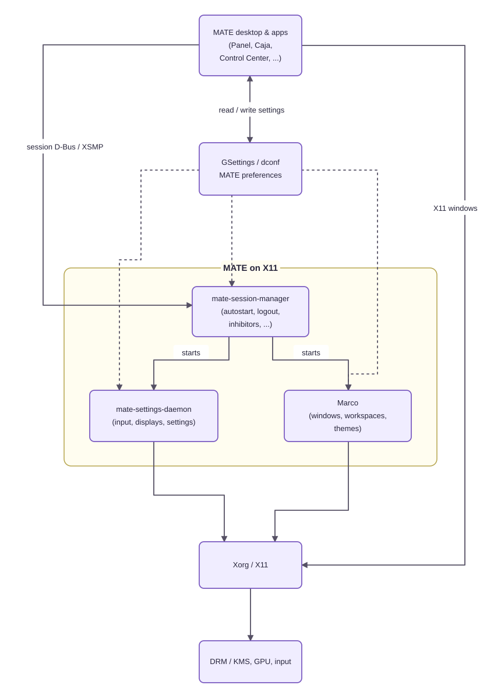
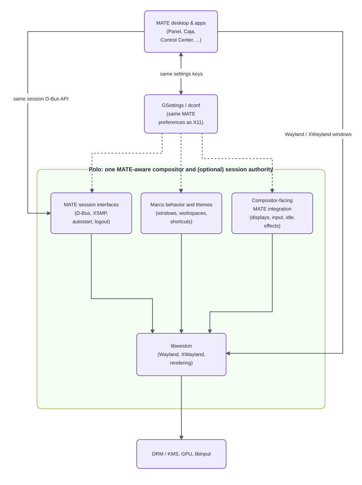
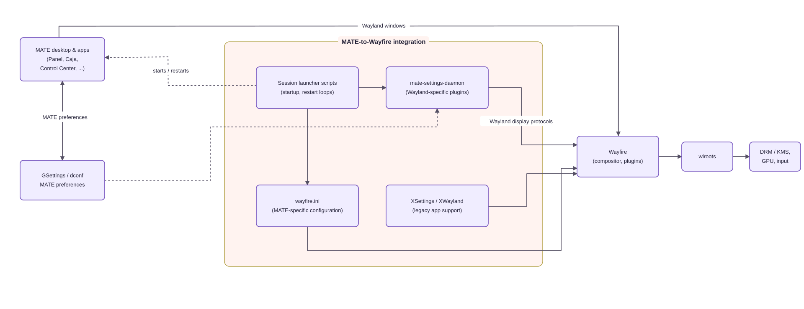

# Polo

Polo is a port of Marco's behavior and window management policies to Wayland, built on libweston and written in Vala and C. It's a window manager, compositor, and session authority for the MATE Wayland desktop. It
takes over, step by step, what Marco, mate-session-manager and the
compositor-facing parts of mate-settings-daemon do on X11.

I am working on this, because Wayfire wasn't designed for MATE or other DEs, yet we've been trying to make MATE fit into it through plugins, workarounds, and compromises.

## Why Polo?

MATE already has a coherent desktop architecture on X11. Polo brings that architecture to Wayland instead of building a MATE session around a compositor designed for a different desktop. 

### MATE on X11 vs. MATE on Polo

MATE applications use the familiar session interfaces and GSettings/dconf preferences. `mate-session-manager` runs the session, `mate-settings-daemon` handles desktop settings, and Marco provides window-management behavior on top of Xorg.

Polo keeps the MATE-facing pieces together. In session mode, applications talk to the **same MATE session D-Bus interfaces**; they continue to use **the same GSettings/dconf keys**. Marco's window rules and themes, session management, compositor-facing settings, and Wayland rendering live inside Polo.

| MATE on X11 | MATE on Polo |
|:-----------:|:------------:|
|  |  |

Polo directly adapts MATE's existing expectations, with [libweston](https://gitlab.freedesktop.org/wayland/weston) handling the Wayland compositor foundations.

### MATE with Wayfire

Wayfire is an extensible, plugin-based Wayland compositor, not a MATE window manager. The existing [MATE Wayland session](https://github.com/mate-desktop/mate-wayland-session) brings the pieces together using a launcher script, Wayfire configuration, and compatibility support. 



### Session management

In session mode Polo is the session manager, compatible with mate-session-manager 1.28 down to its D-Bus API. The panel, Caja, mate-power-manager, mate-screensaver, GTK apps, `mate-session-save` and `mate-session-inhibit` can talk to Polo as they did to the session manager on X11:

- **Autostart** in MATE's phases (Initialization, Window Manager, Panel, Desktop, Application), with conditions, delays and restarts
- **`org.gnome.SessionManager`** — clients, inhibitors, apps and Presence, using the same interfaces as mate-session
- **Log out, shut down, restart** — MATE dialogs and countdown, including the "Some programs are still running" dialog when an app blocks
- **logind** — power off, reboot, suspend, hibernate, switch user, lock before sleep
- **Saved sessions** in `~/.config/mate-session/saved-session`, as with mate-session (`auto-save-session`)
- **XSMP** for legacy X11 applications using libSM
- **mate-settings-daemon** continues running on XWayland since no wayland support; plugins that cannot work on Wayland (xrandr, keyboard, mouse, media keys, accessibility keyboard, background) are disabled only in the Polo session

Polo is still under active development. The goal is to absorb the remaining Marco-style window management and X11-specific integration into a native MATE Wayland session without changing how MATE is supposed to feel.

## Building

The commands below install the build dependencies **and** the companion programs needed for a fully featured runtime. Portal helpers and screenshot tools are runtime dependencies; Polo does not require them to compile.

### Fedora 44

```sh
sudo dnf install gcc gcc-c++ git meson ninja-build python3 pkgconf-pkg-config \
    vala valadoc \
    glib2-devel gtk3-devel gtk-layer-shell-devel \
    wayland-devel wayland-protocols-devel libxkbcommon-devel \
    libinput-devel libevdev-devel libseat-devel systemd-devel \
    libdrm-devel mesa-libgbm-devel libglvnd-devel libdisplay-info-devel \
    pixman-devel cairo-devel pango-devel lcms2-devel libpng-devel \
    libxcb-devel xcb-util-wm-devel xcb-util-errors-devel xcb-util-cursor-devel \
    libXcursor-devel xorg-x11-server-Xwayland-devel \
    libcanberra-devel pulseaudio-libs-devel libSM-devel libICE-devel \
    mate-desktop-devel python3-xlib python3-pyyaml json-glib-devel \
    dconf-devel xdg-desktop-portal xdg-desktop-portal-gtk xdg-desktop-portal-wlr \
    grim wl-clipboard slurp
```

### Debian 14 / Ubuntu 26.04/26.10

```sh
sudo apt install gcc g++ git meson ninja-build python3 pkg-config \
    valac valadoc \
    libglib2.0-dev libgtk-3-dev libgtk-layer-shell-dev \
    libwayland-dev wayland-protocols libxkbcommon-dev \
    libinput-dev libevdev-dev libseat-dev libsystemd-dev libudev-dev \
    libdrm-dev libgbm-dev libegl-dev libgles-dev libdisplay-info-dev \
    libpixman-1-dev libcairo2-dev libpango1.0-dev liblcms2-dev libpng-dev \
    libxcb1-dev libxcb-ewmh-dev libxcb-icccm4-dev libxcb-errors-dev \
    libxcb-cursor-dev libxcursor-dev xwayland libdconf-dev \
    libcanberra-dev libpulse-dev libsm-dev libice-dev \
    libmate-desktop-dev python3-xlib python3-yaml libjson-glib-dev \
    xdg-desktop-portal xdg-desktop-portal-gtk xdg-desktop-portal-wlr \
    grim wl-clipboard slurp
```

Polo needs Vala ≥ 0.56, GLib ≥ 2.80, Meson ≥ 1.4 and wayland-protocols ≥ 1.46 (the minimum Weston 16 requires).

### Build and test

```sh
meson setup build
meson compile -C build
```
And run the whole MATE session (Polo as session manager, autostart, logs in `~/polo-logs/`) from a TTY with:
```sh
./start-polo.sh
```

If you install Polo, you can choose **MATE (Polo)** from your LightDM greeter.

To start a development session from a TTY manually:

```sh
dbus-run-session -- meson devenv -C build polo \
  --backend=drm \
  --exec mate-panel \
  --exec "caja -n --force-desktop"
```
To run the tests:
```
meson test -C build
```


Useful configurations:

| Command | Purpose |
|---|---|
| `meson setup build -Dstrict=true` | C `-Werror`, valac `--fatal-warnings` (CI) |
| `meson setup build-asan -Db_sanitize=address,undefined -Db_lundef=false` | Sanitizers |
| `meson test -C build --suite vapi` | VAPI coverage and boundary checks |
| `meson test -C build --suite lint` | clang-format and vala-lint, when installed |

### Running Polo from the build tree

```sh
# Inside a Wayland session: Polo opens as a window.
meson devenv -C build polo --exec gtk3-demo --exec gtk3-widget-factory

# Inside an X11 session: run a parent Weston on X11 first, then Polo inside
# it. --fullscreen makes Polo's output fill the parent's window.
weston --backend=x11 --shell=kiosk --width=1280 --height=800 --socket=polo-parent &
WAYLAND_DISPLAY=polo-parent meson devenv -C build polo --fullscreen --exec gtk3-demo

# Headless, for scripting and tests.
meson devenv -C build polo --backend=headless --renderer=pixman
```

### Logging

```sh
polo --debug-scopes=polo-policy,drm-backend   # debug output of these scopes only
polo --log=/tmp/polo.log
```

Scopes: `polo`, `polo-policy`, `polo-input`, `polo-xwm`, `polo-session`, `polo-effects` and `polo-protocol`, plus any libweston scope.

## Documentation

Tests and Marco Oracle documentation are in progress.
Planning a wiki page for architecture and maintenance.

## Licence

GPL-3.0-or-later. Imported code keeps its own compatible licence; see `LICENSES/`.
